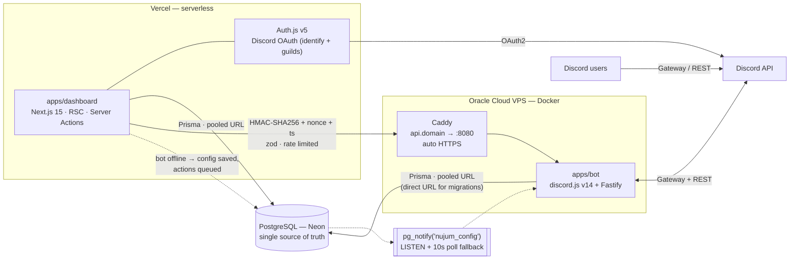

# Nujum

> **نجوم** — "stars". An all-in-one Discord bot and a separate, premium admin dashboard.

Nujum is a production-grade monorepo with two independently deployable apps that share one
PostgreSQL database and one contracts package:

- **`apps/bot`** — discord.js v14 bot + small Fastify API, hosted on an Oracle Cloud VPS in Docker
  behind Caddy (automatic HTTPS). _(Phase 2 complete)_
- **`apps/dashboard`** — Next.js 15 admin dashboard on Vercel. _(Phase 4 complete)_
- **`packages/shared`** — Prisma schema/client, zod contracts, DTOs, constants, permission
  definitions and the HMAC implementation.

> **Status:** Phases 1–4 are complete: workspace, shared contracts and schema, bot foundation, the
> security layer, hot-reload config, live Bot API actions with durable queue draining, and the
> Next.js dashboard with Discord OAuth, server-side authorization, audit/revert and offline queue
> handling. 186 unit tests pass (82 shared + 90 bot + 14 dashboard).

---

## Architecture



### Why this shape

- Vercel cannot reach a database on the VPS, so **hosted PostgreSQL is authoritative**.
- Config flows **dashboard → DB → `NOTIFY` → bot cache invalidation**, so the bot never exposes a
  public config endpoint and settings keep working while the bot is offline.
- Only **live Discord reads/actions** cross the HMAC-authenticated Bot API boundary (channels,
  roles, members, publishing panels, sending messages, lockdown).
- The two apps never import each other; only `@nujum/shared` is shared.

### Data flows

1. **Settings change** — dashboard server action validates with zod → authorizes the user →
   upserts config in a transaction → bumps `Guild.configVersion` → `pg_notify` → writes `AuditLog`.
   The bot receives the payload, invalidates its per-guild cache and hot-reloads.
2. **Live action** — dashboard signs the request (HMAC, timestamp, single-use nonce) → Caddy →
   Fastify verifies signature, replay window and rate limit → performs the Discord action.
3. **Bot offline** — dashboard still writes config and inserts a `PendingBotAction`; the UI shows an
   offline badge and “queued” state. The bot drains the queue when it reconnects.

---

## Repository layout

```
nujum/
├─ apps/
│  ├─ bot/                    # discord.js, Fastify, commands, config watcher, Docker
│  │  ├─ Dockerfile           # multi-stage, multi-arch, non-root
│  │  └─ src/                 # api, client, commands, config, events, handlers, lib
│  └─ dashboard/              # Next.js 15 on Vercel (App Router + Server Actions)
├─ packages/shared/
│  ├─ prisma/
│  │  ├─ schema.prisma        # 66 models, single source of truth
│  │  └─ migrations/20261124000000_init/
│  └─ src/
│     ├─ constants.ts         # brand, enums mirrored for client safety, limits
│     ├─ modules.ts           # 21 module definitions + dashboard paths
│     ├─ permissions.ts       # 34 commands with user/bot permissions & cooldowns
│     ├─ zod/                 # contracts for every config, action and API route
│     ├─ config.ts            # LISTEN/NOTIFY listener + transactional pg_notify writer
│     ├─ hmac.ts              # canonical request, sign, verify, nonce cache
│     ├─ rate-limit.ts        # token buckets + multi-rule limiter
│     ├─ env.ts               # env validation + NEXT_PUBLIC_ secret guard
│     ├─ sanitize.ts          # control-char stripping, mention neutralization
│     ├─ audit-diff.ts        # before/after diff + revert
│     └─ prisma.ts            # serverless-safe Prisma singleton
├─ docker/
│  └─ Caddyfile               # automatic HTTPS reverse proxy for the Bot API
├─ docs/
│  ├─ database.md             # pooling, migrations, NOTIFY, queue semantics
│  ├─ bot.md                  # bot architecture, API contract, deployment
│  └─ security.md             # detectors, verification and escalation
├─ docker-compose.yml         # bot + Caddy production stack
├─ SECURITY.md
└─ README.md
```

---

## Tech stack

| Layer      | Choice                                                                              |
| ---------- | ----------------------------------------------------------------------------------- |
| Runtime    | Node.js 20+, TypeScript strict (`noUncheckedIndexedAccess`)                         |
| Bot        | discord.js v14, Fastify 5, Prisma 6, zod, pino                                      |
| Dashboard  | Next.js 15 (App Router), React 19, Tailwind v4, shadcn/ui, TanStack Query, Recharts |
| Auth       | Auth.js v5, Discord OAuth2 (`identify guilds`), database sessions                   |
| Database   | PostgreSQL (Neon or Supabase), pooled runtime URL + direct migration URL            |
| Queue      | PostgreSQL (`ScheduledAction`, `PendingBotAction`), `FOR UPDATE SKIP LOCKED`        |
| Config bus | `LISTEN/NOTIFY` + 10s polling fallback                                              |
| Hosting    | Oracle Cloud VPS (Docker, Caddy, arm64/amd64) + Vercel                              |

---

## Quickstart

Prerequisites: **Node ≥ 20.11**, **pnpm ≥ 9**, a PostgreSQL 15+ database (Neon recommended).

```bash
pnpm install
cp packages/shared/.env.example packages/shared/.env   # fill DATABASE_URL / DIRECT_URL
pnpm db:deploy          # apply the generated migration (or `pnpm db:migrate` in dev)
pnpm build:shared
pnpm typecheck
pnpm test
pnpm lint
```

Run the bot (see [`docs/bot.md`](docs/bot.md) for the full guide):

```bash
cp apps/bot/.env.example apps/bot/.env    # token, client id, database URL, HMAC secret
pnpm --filter @nujum/bot dev              # tsx watch
pnpm --filter @nujum/bot deploy:commands  # register slash commands
```

Run the dashboard (see [`apps/dashboard/.env.example`](apps/dashboard/.env.example)):

```bash
cp apps/dashboard/.env.example apps/dashboard/.env   # OAuth + bot API HMAC secret
pnpm --filter @nujum/dashboard dev                   # http://localhost:3000
```

Set the Discord OAuth redirect URI to `<NEXT_PUBLIC_APP_URL>/api/auth/callback/discord`. The
HMAC secret must be identical in both apps; a mismatch makes every live action fail with
`UNAUTHORIZED`.

Useful scripts:

| Command                                    | Purpose                                                |
| ------------------------------------------ | ------------------------------------------------------ |
| `pnpm build`                               | Build shared + bot + dashboard (production builds)     |
| `pnpm build:shared`                        | `prisma generate` + compile shared to `dist/`          |
| `pnpm dev:bot`                             | Bot in watch mode                                      |
| `pnpm start:bot`                           | Run the compiled bot                                   |
| `pnpm --filter @nujum/bot start:sharded`   | ShardingManager (requires `SHARD_COUNT>1` and a build) |
| `pnpm --filter @nujum/bot deploy:commands` | Register slash commands (global, or `DEV_GUILD_ID`)    |
| `pnpm db:generate`                         | Regenerate the Prisma client                           |
| `pnpm db:migrate`                          | Create/apply a dev migration                           |
| `pnpm db:deploy`                           | Apply committed migrations (CI/production)             |
| `pnpm db:studio`                           | Prisma Studio                                          |
| `pnpm test` / `pnpm test:watch`            | Vitest                                                 |
| `pnpm format`                              | Prettier                                               |

### Environment

`packages/shared/.env.example` documents the database and HMAC variables shared by both
deployables. Each app has its own example file:

- **Bot** (`apps/bot/.env.example`): Discord token/client ID, dev guild, owner IDs, database URLs,
  API bind/port, HMAC secret (+ previous for rotation), IP allowlist, sharding, presence.
- **Dashboard** (`apps/dashboard/.env.example`): Auth.js secret/URL, Discord OAuth credentials,
  database URLs, bot API base URL + HMAC secret, super-admin IDs, session/re-auth windows and rate
  limits.

Docker deployments add `.env.compose` (see `.env.compose.example`) for the public hostname and ACME
email.

---

## Shared package

| Import                     | Environment     | Contents                                                                                |
| -------------------------- | --------------- | --------------------------------------------------------------------------------------- |
| `@nujum/shared`            | client + server | constants, modules, permissions, types, zod schemas, sanitize, rate limiter, audit diff |
| `@nujum/shared/zod`        | client + server | all request/config contracts                                                            |
| `@nujum/shared/prisma`     | server only     | Prisma client singleton, `Prisma` namespace                                             |
| `@nujum/shared/hmac`       | server only     | sign/verify, nonce cache                                                                |
| `@nujum/shared/env`        | server only     | env parsing, `NEXT_PUBLIC_` guard                                                       |
| `@nujum/shared/rate-limit` | client + server | token buckets                                                                           |

The root entry point intentionally avoids `node:crypto` and Prisma so client components can import
schemas without bundling server code. A parity test keeps every mirrored enum in sync with the
generated Prisma client.

### HMAC contract

```
canonical = `${timestamp}\n${nonce}\n${METHOD}\n${sortedPath}\n${sha256hex(body)}`
signature = hex(HMAC_SHA256(secret, canonical))

headers: x-nujum-key-id, x-nujum-timestamp, x-nujum-nonce, x-nujum-signature
window: 60s · nonce single-use for 5 min · previous secret accepted during rotation
```

Implemented and tested: tampering, wrong method, expired timestamp, replay, malformed headers,
unknown key id and secret rotation.

---

## Database

The schema contains 66 models covering guilds, auth, audit, security, moderation, tickets,
join-to-create, welcome/verification, role panels, logging, leveling and community modules. See
[`docs/database.md`](docs/database.md) for pooling, migrations, NOTIFY and retention.

Highlights:

- Guild-scoped config is **1:1 with `Guild`** (`guildId @id`) so a settings save is one upsert.
- Gap-free per-guild numbering for cases and tickets via counters incremented in the same
  transaction as the insert.
- `ScheduledAction` is the restart-safe scheduler queue; `PendingBotAction` is the offline action
  queue.
- `AuditLog` stores before/after JSON for every dashboard and bot change, with revert metadata.
- Every relation to `Guild` cascades on delete; a 30-day purge job will use `Guild.leftAt`.

---

## Security

Every phase builds on these foundations:

- No hardcoded secrets; `parseEnv` crashes with variable names only (never values).
- `assertNoPublicSecrets` fails the dashboard build if a secret uses `NEXT_PUBLIC_`.
- zod validation + sanitization primitives for every input surface.
- HMAC request signing with timing-safe comparison, replay protection and rotation.
- Token-bucket rate limiting (per user / per guild / global) with multi-rule enforcement.
- Enum parity test prevents schema drift between app code and the database.

See [SECURITY.md](SECURITY.md) for the full model and phase-by-phase controls.

---

## Phase plan

| Phase | Scope                                                           | Status      |
| ----- | --------------------------------------------------------------- | ----------- |
| 1     | Monorepo, shared package, Prisma schema, migration, tests       | ✅ complete |
| 2     | Bot foundation: client, handlers, commands, Docker              | ✅ complete |
| 3     | Bot security layer: permissions, hierarchy, anti-raid/nuke/spam | ✅ complete |
| 4     | Config hot-reload, Bot API live actions/queue, dashboard client | ✅ complete |
| 5     | Dashboard auth, layout, landing                                 | ✅ complete |
| 6–13  | Tickets, JTC, help, moderation, logging, welcome, pages, extras |             |
| 14    | Deployment docs, CI/CD, Playwright E2E                          |             |

---

## License

Proprietary — all rights reserved. See `SECURITY.md` for vulnerability reporting.
